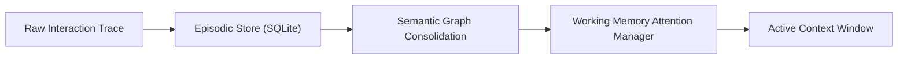

# Swimlane — Core Cognitive Memory Engine

FORK: B (task-driven)
lane-meta: thread=yes · risk=low · owner=core

## Seam

The Core Cognitive Engine provides the primary internal interface for persistence, associative retrieval, semantic consolidation, and attention management. It exposes direct Python library bindings consumed by interface adapters and visual services.

## Architecture

1. Raw interaction traces enter through the episodic logging boundary.
2. SQLite WAL engine persists timestamped episodes with topic tags and salience metrics.
3. Asynchronous consolidation extracts knowledge triples into an associative graph.
4. Working memory manager prunes active contexts to respect token ceilings.

## Non-Goals

- Remote cloud network coordination or multi-tenant database replication.
- Direct network socket serving (handled by interface layer).

## Legs

| Leg | Responsibility |
|---|---|
| [leg-01-storage.md](leg-01-storage.md) | Local SQLite persistence schema and episode recording |
| [leg-02-semantic.md](leg-02-semantic.md) | Triple extraction and semantic knowledge graph engine |
| [leg-03-working.md](leg-03-working.md) | Working memory attention budget and context pruning |

## Dependencies

- Core engine has zero upstream dependencies; it is the foundation layer.
- Inherits constraints established in ADR 0001 and ADR 0002.

## Build order

1. `leg-01-storage` establishes baseline episode schema and storage.
2. `leg-02-semantic` enables associative knowledge distillation.
3. `leg-03-working` layers attention budgeting over stored representations.

## Open questions

- question: "What is the initial threshold for memory decay pruning?"
  owner: Zaiden
  blocks: None
