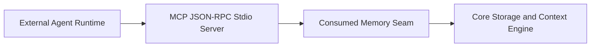

# Swimlane — Interface and MCP Binding

FORK: B (task-driven)
lane-meta: thread=no · risk=med · owner=interface

## Seam

This downstream lane consumes the seam provided by the Core Cognitive Memory Engine. It exposes standard Model Context Protocol (MCP) tool endpoints and CLI integration hooks for external execution environments.
Seam evolution rule: additive changes to the core memory API (e.g. optional metadata fields) are adopted non-breakingly; breaking alterations require a transition period with backward-compatible adapters.

## Architecture

1. External agent runtimes issue standardized MCP tool calls (`recall_memory`, `store_episode`, `inspect_knowledge`).
2. Stdio / SSE protocol listener parses JSON-RPC requests.
3. Invocation routes across the consumed memory seam into core routines.
4. Serialized memory structures return to the agent within 500ms.

## Non-Goals

- Implementing proprietary agent prompt logic or LLM generation loops.
- Re-architecting internal SQLite tables (delegated entirely to core).

## Legs

| Leg | Responsibility |
|---|---|
| [leg-01-mcp-server.md](leg-01-mcp-server.md) | Standardized MCP server exposing JSON-RPC memory tools |
| [leg-02-converge-hook.md](leg-02-converge-hook.md) | Converge task loop hook for automated pre-flight recall and settlement |

## Dependencies

- Depends directly on the Core Cognitive Engine seam.
- Inherits constraints established in ADR 0003.

## Build order

1. `leg-01-mcp-server` wraps core memory operations as MCP tool endpoints.
2. `leg-02-converge-hook` wires the MCP endpoints into Converge task-loop pre-flight and settlement phases.

## Open questions

- question: "Should MCP notifications be streamed asynchronously during episode consolidation?"
  owner: Zaiden
  blocks: None
