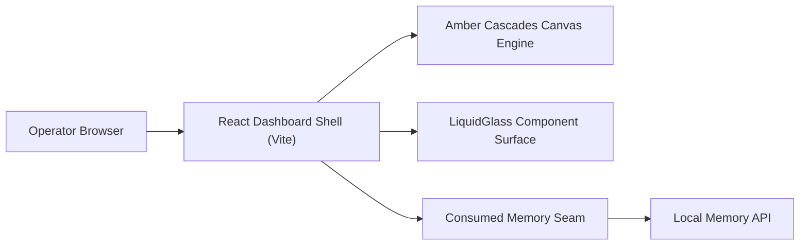

# Swimlane — Visual Dashboard and Inspector

FORK: B (task-driven)
lane-meta: thread=no · risk=low · owner=frontend

## Seam

This downstream lane consumes the seam provided by the Core Cognitive Memory Engine and Interface server. It renders inspection queries, knowledge graphs, and memory governance controls.
Seam evolution rule: additive changes to exported memory schema properties are rendered gracefully; breaking changes or property removals require schema compatibility fallbacks.

## Architecture

1. Operator navigates to local dashboard URL in a browser.
2. React shell boots with dark minimalist typography (EB Garamond, GeistMono) and Amber Cascades canvas animation.
3. LiquidGlass displacement filter provides optical refraction over active controls.
4. Data fetches query local memory endpoints to render episodes and graphs within 300ms.

## Non-Goals

- Executing background model inferences directly in browser JavaScript.
- Cloud hosting or serverless deployment pipelines (local-first tool).

## Legs

| Leg | Responsibility |
|---|---|
| [leg-01-dashboard-shell.md](leg-01-dashboard-shell.md) | React Vite application shell with dark luxury typography and Amber Cascades canvas |
| [leg-02-graph-explorer.md](leg-02-graph-explorer.md) | Interactive knowledge graph visualizer and episodic timeline inspector |

## Dependencies

- Consumes the Core Cognitive Memory Engine and Interface API seams.
- Inherits constraints established in ADR 0004.

## Build order

1. `leg-01-dashboard-shell` scaffolds Vite React project, typography, canvas simulation, and LiquidGlass button.
2. `leg-02-graph-explorer` connects real memory endpoints to interactive graph and timeline visualizations.

## Open questions

- question: "Should the Amber Cascades canvas support mouse proximity particle physics?"
  owner: Zaiden
  blocks: None
